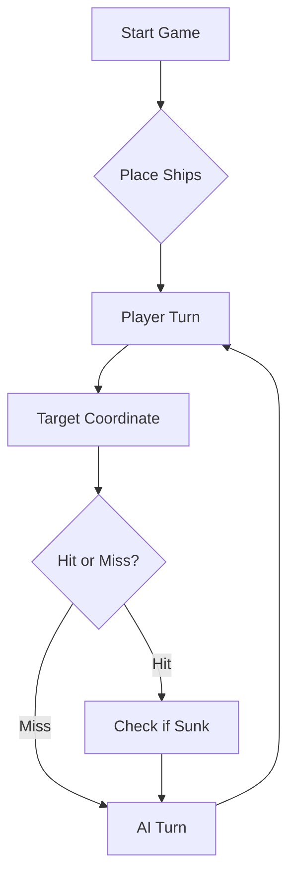

# ⚓ Battleship 2.0

### Grupo: TP01_LETI-3

Nome | Licenciatura | N.º de aluno | Conta Github
--- | --- | --- | ---
Rui Alves | LTDIA | 130755 | LETI-130755
Tiago Cunha | LETI | 129808 | LETI-129808
Tomás Santos | LETI | 98458 | LETI-98458


> A modern take on the classic naval warfare game, designed for the XVII century setting with updated software engineering patterns.

---

## 📖 Table of Contents
- [Project Overview](#-project-overview)
- [Key Features](#-key-features)
- [Technical Stack](#-technical-stack)
- [Installation & Setup](#-installation--setup)
- [Code Architecture](#-code-architecture)
- [Roadmap](#-roadmap)
- [Contributing](#-contributing)

---

## 🎯 Project Overview
This project serves as a template and reference for students learning **Object-Oriented Programming (OOP)** and **Software Quality**. It simulates a battleship environment where players must strategically place ships and sink the enemy fleet.

### 🎮 The Rules
The game is played on a grid (typically 10x10). The coordinate system is defined as:

$$(x, y) \in \{0, \dots, 9\} \times \{0, \dots, 9\}$$

Hits are calculated based on the intersection of the shot vector and the ship's bounding box.

---

## ✨ Key Features
| Feature | Description | Status |
| :--- | :--- | :---: |
| **Grid System** | Flexible $N \times N$ board generation. | ✅ |
| **Ship Varieties** | Galleons, Frigates, and Brigantines (XVII Century theme). | ✅ |
| **AI Opponent** | Heuristic-based targeting system. | 🚧 |
| **Network Play** | Socket-based multiplayer. | ❌ |

---

## 🛠 Technical Stack
* **Language:** Java 17
* **Build Tool:** Maven / Gradle
* **Testing:** JUnit 5
* **Logging:** Log4j2

---

## 🚀 Installation & Setup

### Prerequisites
* JDK 17 or higher
* Git

### Step-by-Step
1. **Clone the repository:**
   ```bash
   git clone [https://github.com/britoeabreu/Battleship2.git](https://github.com/britoeabreu/Battleship2.git)
   ```
2. **Navigate to directory:**
   ```bash
   cd Battleship2
   ```
3. **Compile and Run:**
   ```bash
   javac Main.java && java Main
   ```

---

## 📚 Documentation

You can access the generated Javadoc here:

👉 [Battleship2 API Documentation](https://britoeabreu.github.io/Battleship2/)


### Core Logic
```java
public class Ship {
    private String name;
    private int size;
    private boolean isSunk;

    // TODO: Implement damage logic
    public void hit() {
        // Implementation here
    }
}
```

### Design Patterns Used:
- **Strategy Pattern:** For different AI difficulty levels.
- **Observer Pattern:** To update the UI when a ship is hit.
</details>

### Logic Flow


---

## 🗺 Roadmap
- [x] Basic grid implementation
- [x] Ship placement validation
- [ ] Add sound effects (SFX)
- [ ] Implement "Fog of War" mechanic
- [ ] **Multiplayer Integration** (High Priority)

---

### Prompt final de estratégia para LLMs
Considere agora a seguinte tática de geração de rajadas de tiros para a Batalha Naval dos Descobrimentos Portugueses.
O tabuleiro possui linhas A a J e colunas 1 a 10. A minha frota tem 11 navios: 4 Barcas (1), 3 Caravelas (2), 2 Naus (3), 1 Fragata (4) e 1 Galeão (5 posições em T: corpo linear de 3 posições e 2 posições nas extremidades/asas).
Nenhum navio toca noutro, nem na diagonal (espaçamento mínimo obrigatório de 1 casa).
Eu sou o adversário e devolverei após cada jogada a estrutura JSON gerada pelo motor do jogo.

REGRAS DE OURO DE MEMÓRIA E VALIDADE (Tolerância Zero a Repetições):
1. Proibição Absoluta de Tiros Repetidos: Nunca dispare numa coordenada já disparada em qualquer jogada anterior nem em casas marcadas como água certa (-).
2. Validação Obrigatória Antes de Submeter: Antes de gerar a nova rajada, confirme que nenhuma das 3 coordenadas consta na sua lista cumulativa de disparos já efetuados.
3. Resposta Agregada: A resposta do jogo é conjunta para os 3 tiros. Se obtiver "hitsOnBoats", não invente qual deles acertou; triangule nas jogadas seguintes testando as células adjacentes (N, S, E, O).

FORMATO OBRIGATÓRIO DE CADA RESPOSTA (estritamente estas 5 secções):
1. Diário de Bordo: Rajada anterior, deduções lógicas, acertos confirmados ou descartados.
2. Histórico Cumulativo de Tiros: Lista exaustiva em texto de TODAS as coordenadas já alvejadas até à jogada atual (ex.: A2, B2, B4, C3, D5, E7, H4...).
3. Frota Restante: Contagem das embarcações ainda a flutuar.
4. Mapa 10x10 Atualizado:
   Símbolos:
   ·= Desconhecido
   o= Água confirmada
   ?= Tiro disparado (a aguardar resolução de ambiguidade)
   X= Acerto confirmado em navio a flutuar
   #= Navio afundado
   - = Água certa (halo de 1 casa em redor de navio afundado ou diagonais proibidas)
5. Nova Rajada (3 tiros válidos):
   - Formato JSON (Array simples conforme guião):
[
  {"row": "...", "column": ...},
  {"row": "...", "column": ...},
  {"row": "...", "column": ...}
]
   - Coordenadas para consola: <coord1> <coord2> <coord3> (ex.: B2 E5 H8)

TÁTICA:
- Modo Caça: Enquanto não houver suspeitas ativas, explore o padrão de xadrez (onde a soma da linha [A=1..J=10] + coluna é par), espaçando os 3 tiros por diferentes quadrantes do mapa.
- Modo Ataque: Perante acertos, investigue as posições ortogonais livres (N, S, E, O). As Caravelas, Naus e Fragatas são linhas retas; assim que descobrir 2 acertos alinhados, explore as pontas. Para navios em linha, as diagonais aos acertos são água certa (-).
- O Galeão: Tem formato em T. Se encontrar acertos contíguos não alinhados, suspeite da junção do Galeão e explore a terceira direção ortogonal.
- Halo de Afundamento: Assim que o relatório indicar "sunkBoats", determine as coordenadas da carcaça (#) e preencha imediatamente todo o perímetro de 1 casa em seu redor (inclusive diagonais) com água certa (-).
- Fim de Jogo: Quando todos os 11 navios forem afundados, encerre com uma declaração de vitória.

Quando eu escrever "Começa", inicie a Rajada 1.

## 🧪 Testing
We use high-coverage unit testing to ensure game stability. Run tests using:
```bash
mvn test
```

> [!TIP]
> Use the `-Dtest=ClassName` flag to run specific test suites during development.

---

## 🤝 Contributing
Contributions are what make the open-source community such an amazing place to learn, inspire, and create.

1. Fork the Project
2. Create your Feature Branch (`git checkout -b feature/AmazingFeature`)
3. Commit your Changes (`git commit -m 'Add some AmazingFeature'`)
4. Push to the Branch (`git push origin feature/AmazingFeature`)
5. Open a **Pull Request**

---

## 📄 License
Distributed under the MIT License. See `LICENSE` for more information.

---
**Maintained by:** [@britoeabreu](https://github.com/britoeabreu)  
*Created for the Software Engineering students at ISCTE-IUL.*
